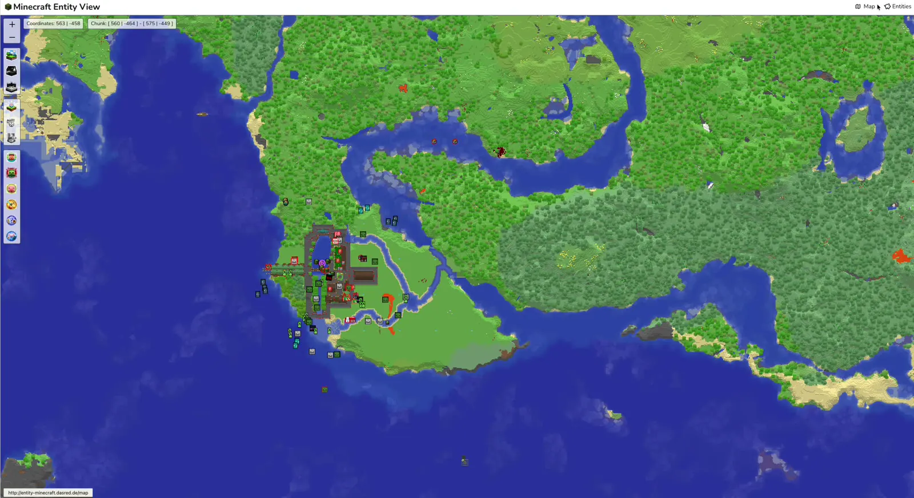

# minecraft-entity-view

Live map and statistics of all entities on a Minecraft server in the browser: every mob, item and player on the map of
the overworld, the nether and the end, the status of every loaded chunk, counts per category over time – and a button
to remove stuck entities via RCON.



**Documentation:** https://www.marco-starker.de/en/projects/minecraft-entity-view/docs
(German: https://www.marco-starker.de/de/projekte/minecraft-entity-view/doku)

## Compatibility

- Minecraft 1.21.8 with NeoForge 21.8.33 or newer
- [minecraft-api](https://github.com/DasRed/minecraft-api) on the Minecraft server (data source)
- [squaremap](https://github.com/jpenilla/squaremap) on the Minecraft server (optional, map background)
- Node.js 26.12.1 or newer, npm 11.20 or newer

## Status

This project is **no longer developed**. It works with Minecraft 1.21.8; there are no plans to port it to newer
versions. Forks are welcome.

## Quick start

```bash
cp .env.example .env   # set MINECRAFT_SERVER, WEBSOCKET_CLIENT, TILE_LAYER_SERVER, RCON_*
npm ci
npm run build
npm start
```

| Part                              | Port   |
|-----------------------------------|--------|
| Frontend (`apps/frontend`)        | `7790` |
| WebSocket backend (`apps/backend`)| `7791` |
| Tile proxy (`apps/squaremapProxy`)| `7792` |

The application has no login. Run it only within your own network or behind a reverse proxy with access control.

## License

[MIT](LICENSE)
