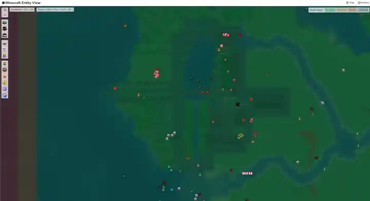

`minecraft-entity-view` zeigt im Browser, was auf einem Minecraft-Server gerade lebt und herumliegt – live und ohne
dass du selbst im Spiel sein musst:

- **Karte:** jede Entity als Symbol auf der Karte von Oberwelt, Nether und End, dazu der Status jedes geladenen Chunks
- **Statistik:** Anzahl der Entities je Kategorie im Zeitverlauf und Tabellen mit jedem Mob, Item und Fahrzeug
- **Aufräumen:** einzelne Entities direkt aus dem Browser entfernen, zum Beispiel ein vergessenes Boot oder einen
  Mob, der seit Tagen in einer Farm feststeckt

Typische Fragen, die die Karte in Sekunden beantwortet: Wo sammeln sich Mobs? Welche Chunks bleiben dauerhaft aktiv?
Welche Farm produziert mehr Items, als jemand einsammelt? Warum spawnt in der Mobfarm nichts mehr?

## Aufbau

Das Projekt besteht aus drei Teilen, die zusammen gestartet werden:

| Teil                | Aufgabe                                                                                     |
|---------------------|---------------------------------------------------------------------------------------------|
| **Backend**         | fragt die [minecraft-api](https://www.marco-starker.de/de/projekte/minecraft-api) alle 50 ms ab und schickt Änderungen per WebSocket an den Browser; entfernt Entities per RCON |
| **Frontend**        | React-App mit Leaflet-Karte und Statistik                                                    |
| **Kachel-Proxy**    | reicht die Kartenkacheln von [squaremap](https://github.com/jpenilla/squaremap) mit CORS-Kopfzeilen an den Browser weiter |

Auf dem Minecraft-Server laufen dafür die Mod `minecraft-api` und – für den Kartenhintergrund – squaremap.

## Kompatibilität

| Spiel                    | Loader                        | Laufzeit                      |
|--------------------------|-------------------------------|-------------------------------|
| Minecraft 1.21.8 (genau) | NeoForge 21.8.33 oder neuer   | Node.js 26.12.1 oder neuer    |

## Status

> [!IMPORTANT]
> Das Projekt wird nicht mehr weiterentwickelt. Es funktioniert mit Minecraft 1.21.8 und der passenden
> `minecraft-api`, Anpassungen an neuere Versionen sind nicht geplant. Der Code bleibt öffentlich – Forks sind
> willkommen.

## Weiter

- [Installation](installation.md): Minecraft-Server vorbereiten und die Anwendung starten
- [Konfiguration](configuration.md): alle Umgebungsvariablen
- [Verwendung](usage.md): Karte und Statistik im Detail

## Verwandte Projekte

- [minecraft-api](https://www.marco-starker.de/de/projekte/minecraft-api): die Mod, die die Daten liefert.
- [mob-cap-multiplier](https://www.marco-starker.de/de/projekte/mob-cap-multiplier): verändert das Mob-Cap je
  Kategorie – die Wirkung siehst du direkt in der Statistik.
