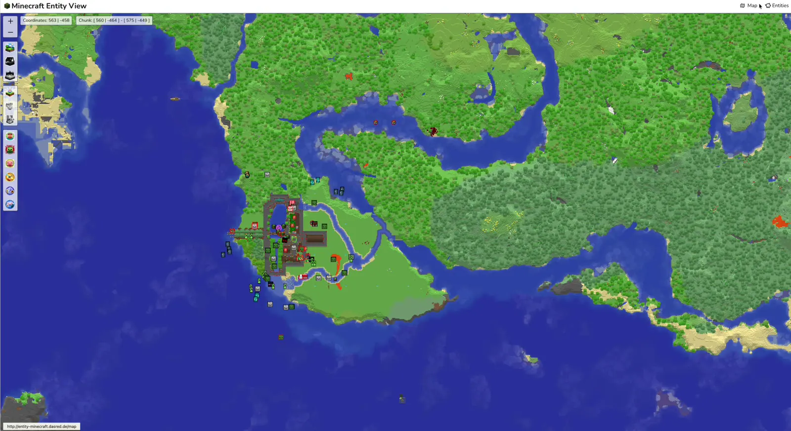
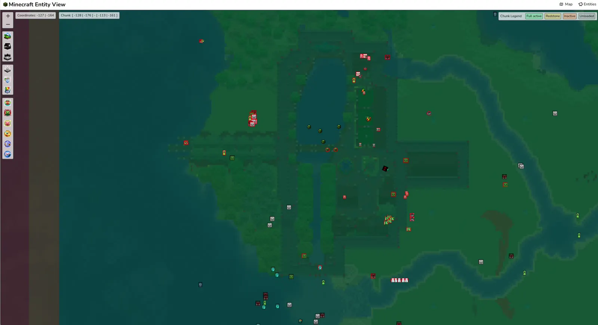
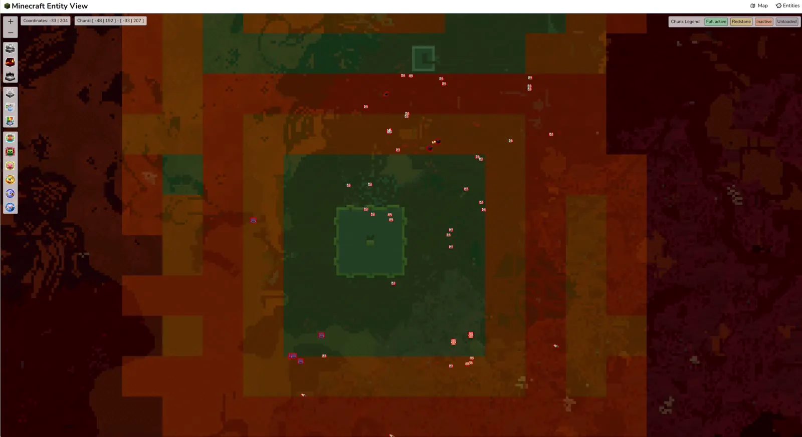
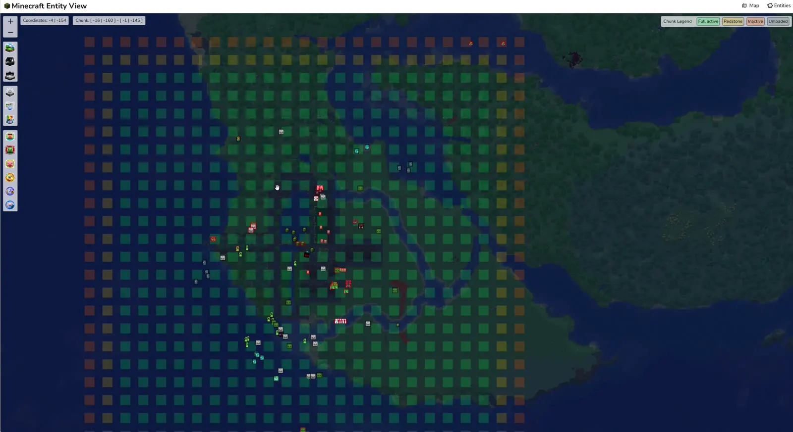
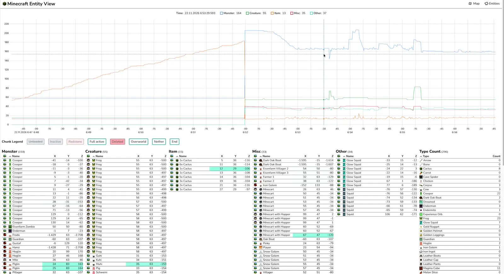

Oben rechts wechselst du zwischen **Map** (Karte) und **Entities** (Statistik). Beide Ansichten aktualisieren sich
laufend, ein Neuladen ist nie nötig.

## Karte

Jede Entity erscheint als kleines Bild ihres Typs, Spieler mit Blickrichtung. Fährst du mit der Maus darüber, zeigt ein
Hinweis Name, Koordinaten und wie lange die Entity schon existiert. Oben links siehst du die Blockkoordinaten unter dem
Mauszeiger und den Chunk, in dem sie liegen.

Die Leiste am linken Rand:

| Schaltfläche           | Wirkung                                                                         |
|------------------------|---------------------------------------------------------------------------------|
| `+` / `−`              | zoomen                                                                          |
| Oberwelt, Nether, End  | Dimension wechseln                                                              |
| Chunk Status           | geladene Chunks farbig einblenden                                               |
| Tiles darken           | Kartenhintergrund abdunkeln, damit die Entities besser hervortreten             |
| Spawn                  | Spawnpunkt der Dimension anzeigen                                               |
| Player, Monster, Creature, Item, Misc, Other | Kategorien ein- und ausblenden                            |

Entities, die länger als 12 Stunden existieren, bekommen einen roten Rand – oft sind das Mobs, die irgendwo
feststecken und nie despawnen. Die Grenze stellst du mit `ENTITY_HIGHLIGHT_IF_OLDER_THAN` ein.

### Chunk-Status

| Farbe | Bedeutung                                                                    |
|-------|------------------------------------------------------------------------------|
| Grün  | **Full active:** alles läuft, Mobs bewegen sich, Farmen arbeiten              |
| Gelb  | **Redstone:** Blöcke und Redstone laufen, Entities stehen still               |
| Orange| **Inactive:** geladen, aber nichts wird berechnet                             |
| Grau  | **Unloaded:** wird gerade geladen oder entladen                               |

Typisch ist ein grüner Bereich um jeden Spieler mit gelbem und orangem Rand. Bleibt irgendwo ohne Spieler ein grüner
Bereich stehen, hält etwas den Chunk geladen – etwa ein Chunk-Loader.

### Entities entfernen

Ist RCON eingerichtet, zeigt der Hinweis einer Entity einen Totenkopf. Ein Klick darauf schickt `kill <uuid>` an den
Server. Spieler lassen sich so nicht entfernen.

> [!WARNING]
> Entfernt ist entfernt: Auch benannte Tiere, Dorfbewohner und Items verschwinden ohne Rückfrage.

## Statistik

Das Diagramm zeigt die Anzahl der Entities je Kategorie im Zeitverlauf. So siehst du zum Beispiel, wie schnell sich
Items vor einer Farm anhäufen oder ob eine geänderte Mob-Cap wirkt.

Darunter filtern die Schaltflächen die Tabellen:

- **Unloaded, Inactive, Redstone, Full active:** Entities nach dem Status ihres Chunks
- **Deleted:** Entities, die gerade verschwunden sind, noch kurz blass anzeigen
- **Overworld, Nether, End:** nach Dimension

Die Tabellen **Monster**, **Creature**, **Item**, **Misc** und **Other** listen jede Entity mit Name und Koordinaten.
Neue Entities sind hinterlegt, Koordinaten, die sich gerade geändert haben, blinken kurz grün auf. **Type Count** zählt
alle Entities je Typ.
