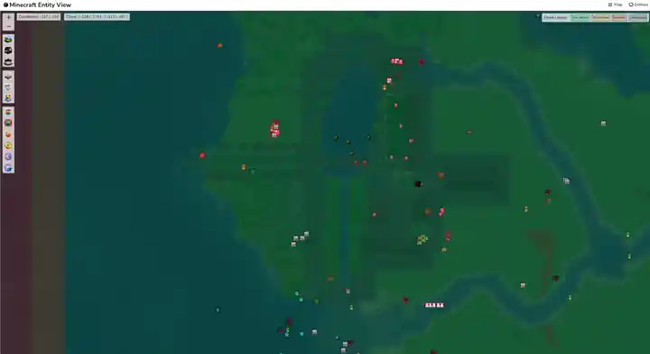

`minecraft-entity-view` shows in the browser what is currently living and lying around on a Minecraft server – live,
without having to be in game yourself:

- **Map:** every entity as an icon on the map of the overworld, the nether and the end, plus the status of every
  loaded chunk
- **Statistics:** number of entities per category over time and tables with every mob, item and vehicle
- **Clean-up:** remove single entities straight from the browser, for example a forgotten boat or a mob that has been
  stuck in a farm for days

Typical questions the map answers in seconds: where do mobs pile up? Which chunks stay active all the time? Which farm
produces more items than anyone collects? Why does the mob farm stop spawning?

## Architecture

The project consists of three parts that are started together:

| Part                | Job                                                                                         |
|---------------------|---------------------------------------------------------------------------------------------|
| **Backend**         | polls [minecraft-api](https://www.marco-starker.de/en/projects/minecraft-api) every 50 ms and sends changes to the browser over WebSocket; removes entities via RCON |
| **Frontend**        | React app with a Leaflet map and statistics                                                  |
| **Tile proxy**      | passes the map tiles of [squaremap](https://github.com/jpenilla/squaremap) on to the browser with CORS headers |

On the Minecraft server this needs the mod `minecraft-api` and – for the map background – squaremap.

## Compatibility

| Game                       | Loader                        | Runtime                       |
|----------------------------|-------------------------------|-------------------------------|
| Minecraft 1.21.8 (exactly) | NeoForge 21.8.33 or newer     | Node.js 26.12.1 or newer      |

## Status

> [!IMPORTANT]
> The project is no longer developed. It works with Minecraft 1.21.8 and the matching `minecraft-api`; updates for newer
> versions are not planned. The code stays public – forks are welcome.

## Next

- [Installation](installation.md): prepare the Minecraft server and start the application
- [Configuration](configuration.md): all environment variables
- [Usage](usage.md): map and statistics in detail

## Related projects

- [minecraft-api](https://www.marco-starker.de/en/projects/minecraft-api): the mod that delivers the data.
- [mob-cap-multiplier](https://www.marco-starker.de/en/projects/mob-cap-multiplier): changes the mob cap per category –
  you see the effect right in the statistics.
