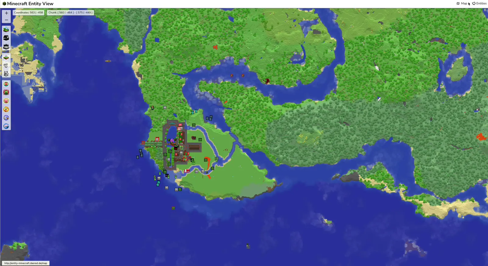
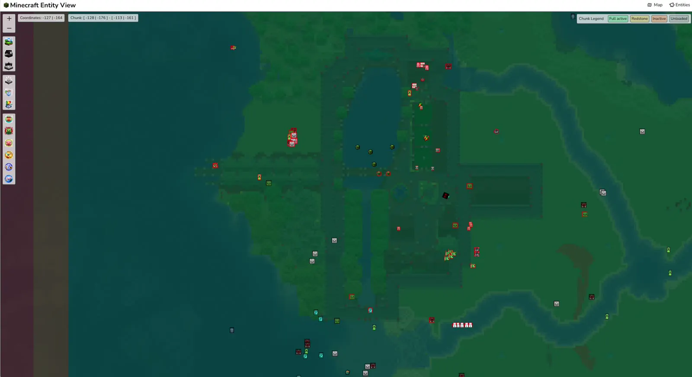
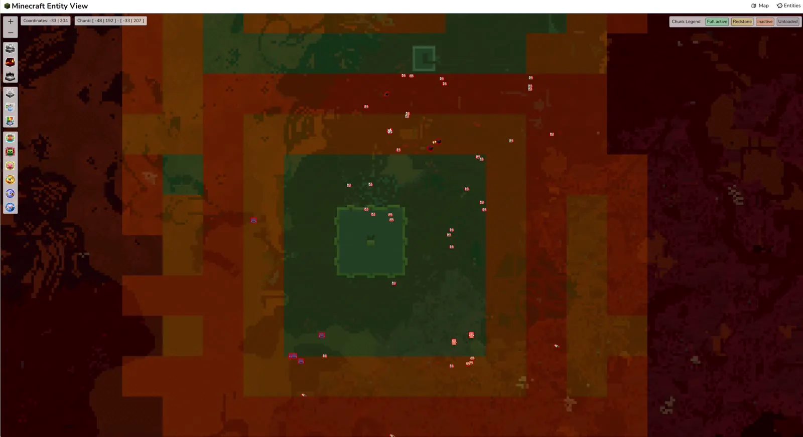
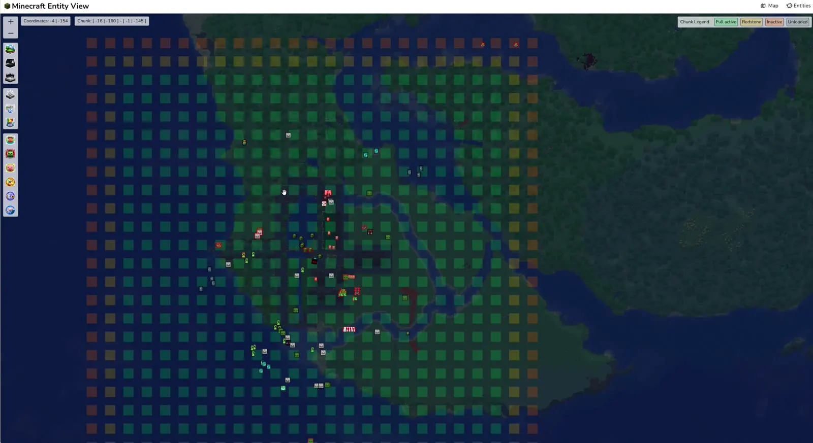
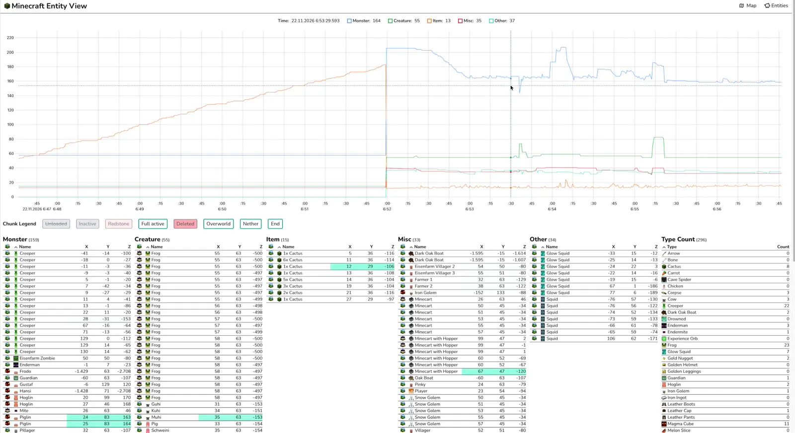

In the top right corner you switch between **Map** and **Entities** (statistics). Both views update continuously; you
never need to reload.

## Map

Every entity appears as a small picture of its type, players with their viewing direction. Hovering shows a tooltip
with name, coordinates and how long the entity has existed. In the top left corner you see the block coordinates under
the mouse pointer and the chunk they are in.

The bar on the left:

| Button                 | Effect                                                                          |
|------------------------|---------------------------------------------------------------------------------|
| `+` / `−`              | zoom                                                                            |
| Overworld, Nether, End | switch dimension                                                                |
| Chunk Status           | show loaded chunks in colour                                                    |
| Tiles darken           | darken the map background so entities stand out more                            |
| Spawn                  | show the spawn point of the dimension                                           |
| Player, Monster, Creature, Item, Misc, Other | show or hide categories                                   |

Entities that have existed for more than 12 hours get a red outline – often these are mobs stuck somewhere that never
despawn. Set the limit with `ENTITY_HIGHLIGHT_IF_OLDER_THAN`.

### Chunk status

| Colour | Meaning                                                                      |
|--------|------------------------------------------------------------------------------|
| Green  | **Full active:** everything runs, mobs move, farms work                      |
| Yellow | **Redstone:** blocks and redstone run, entities stand still                  |
| Orange | **Inactive:** loaded, but nothing is processed                               |
| Grey   | **Unloaded:** being loaded or unloaded                                       |

Typically there is a green area around every player with a yellow and orange border. If a green area stays somewhere
without a player, something keeps the chunk loaded – a chunk loader, say.

### Remove entities

With RCON set up, the tooltip of an entity shows a skull. Clicking it sends `kill <uuid>` to the server. Players cannot
be removed this way.

> [!WARNING]
> Removed is removed: named pets, villagers and items disappear without confirmation too.

## Statistics

The chart shows the number of entities per category over time. You see, for example, how fast items pile up in front
of a farm or whether a changed mob cap takes effect.

Below it, the buttons filter the tables:

- **Unloaded, Inactive, Redstone, Full active:** entities by the status of their chunk
- **Deleted:** keep entities that just vanished visible for a moment, faded
- **Overworld, Nether, End:** by dimension

The tables **Monster**, **Creature**, **Item**, **Misc** and **Other** list every entity with name and coordinates. New
entities are highlighted, coordinates that just changed flash green. **Type Count** counts all entities per type.
